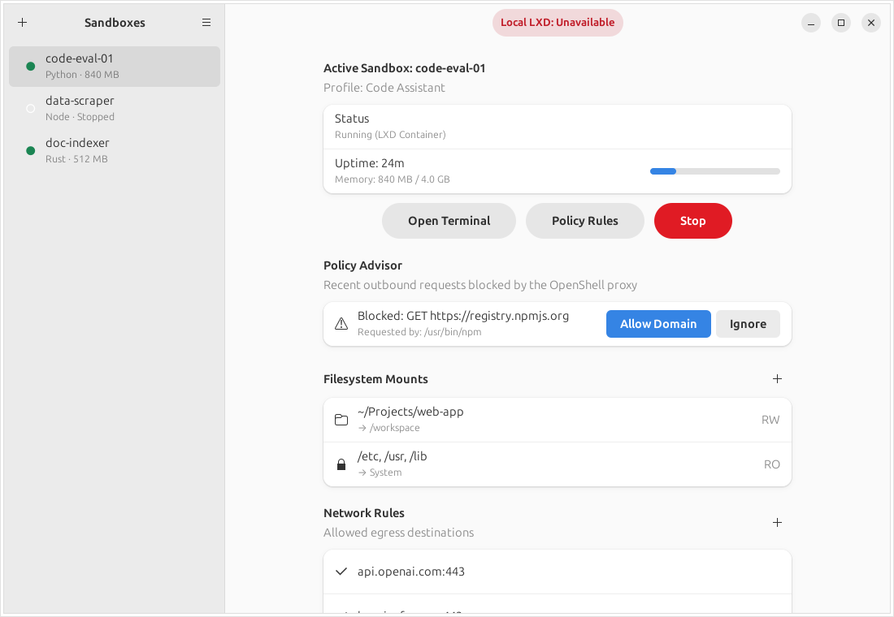

# OpenShell Desktop

A native GNOME desktop manager for [NVIDIA OpenShell](https://github.com/NVIDIA/OpenShell)
agent sandboxes, running on local LXD or a MicroCloud cluster.



> **Status:** early prototype. The UI is a skeleton backed by sample data; the
> only live integration is an LXD health probe on the snap socket.

- [Product & technical spec](docs/SPEC.md)
- [Compute driver research](docs/compute-driver-research.md): why we need an
  out-of-tree `openshell-driver-lxd` and how it plugs into the gateway.

## Building

Requires Rust (2024 edition), GTK ≥ 4.14 and libadwaita ≥ 1.5 (Ubuntu 24.04 or newer).
The app is plain gtk4-rs + libadwaita with a GtkBuilder template, the same
stack as GNOME's own Rust apps, so it picks up Ubuntu's Yaru icons, fonts and
accent colour like any other GNOME app on the desktop.

```sh
sudo apt install libgtk-4-dev libadwaita-1-dev
cargo run
```

## Layout

| Path | What |
|---|---|
| `data/ui/window.ui` | Window layout as a GtkBuilder template: split view, header bar, primary menu |
| `src/ui/window.rs` | `AdwApplicationWindow` subclass bound to the template; state, actions, status pill |
| `src/ui/sidebar.rs` | Sandbox list |
| `src/ui/detail.rs` | Sandbox detail `AdwPreferencesPage` (status, Policy Advisor, mounts, network, resources) |
| `src/model.rs` | View-model types and sample data |
| `src/backend/lxd.rs` | LXD socket health probe |
